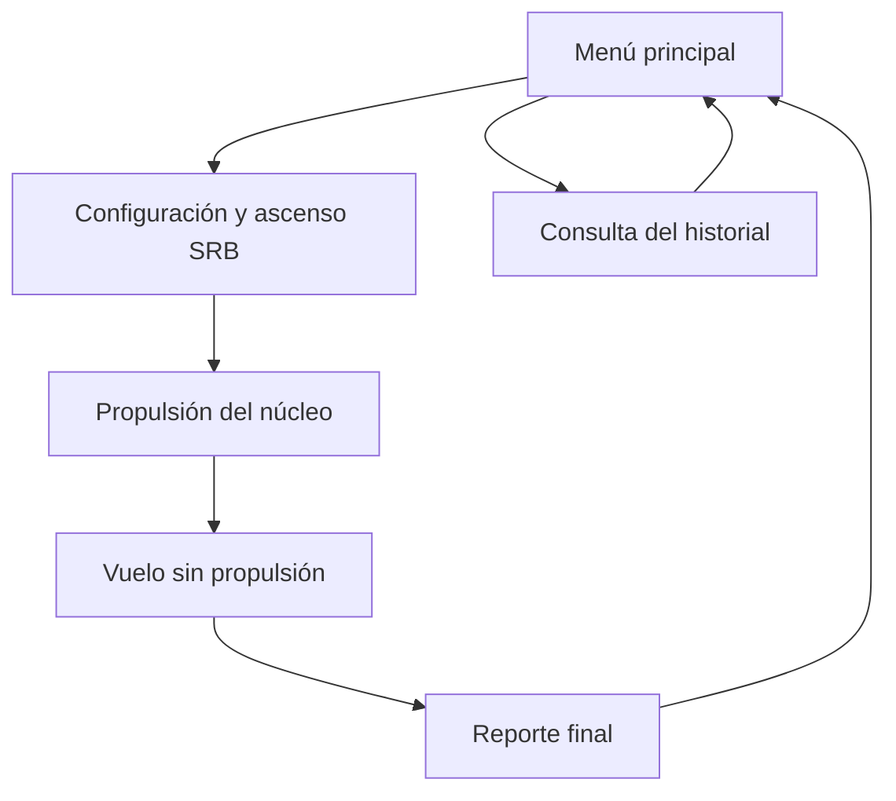

# 🚀 Simulador de Misiones Artemis

**Trabajo Práctico Integrador Final — Lenguaje C**  
**Materia:** Algoritmos y Estructuras de Datos — UTN FRRe, Resistencia  
**Comisión:** [A]

## Integrantes y legajos

- Aramayo Mariano Andrés — Legajo: 25629.
- [briant lopez] — Legajo: [29371].
- [Marcos Sebastian Márquez ] — Legajo: [28469].

---

## 📝 Descripción

Este proyecto consiste en un simulador de consola desarrollado en C, basado en: **Situación-Problema 1: Ascenso y Propulsión con el SLS (MRUV y Desprendimiento)**.

Representa el ascenso vertical del cohete Space Launch System (SLS), que transporta a la nave Orion desde la plataforma de lanzamiento. Se parte del reposo y de una altura de cero metros. La misión se divide en tres fases:

1. **Ascenso con los cohetes auxiliares SRB:** la nave acelera de forma constante hasta el instante del desprendimiento. Con los valores originales, la aceleración es de 20 m/s² y el desprendimiento ocurre a los 120 segundos.
2. **Propulsión del núcleo:** tras separarse los SRB, el motor del núcleo continúa impulsando la nave. La aceleración original es de 12,5 m/s² y los motores se apagan al alcanzar los 160000 metros de altura.
3. **Vuelo sin propulsión:** después del apagado, la nave sigue subiendo por su velocidad inicial, pero la gravedad reduce su velocidad hasta llegar a cero. En ese momento alcanza su altura máxima y finaliza la simulación.

El modelo utiliza aceleraciones netas constantes y una gravedad fija de **9,80 m/s²**. No considera la resistencia del aire ni la variación de la gravedad con la altura. No simula órbitas ni el descenso posterior.

El sistema permite:

- Elegir los valores originales del enunciado o ingresar valores personalizados.
- Calcular la velocidad y la altura al desprenderse los SRB.
- Expresar la aceleración de la primera fase en múltiplos de la gravedad terrestre.
- Simular la segunda fase y el vuelo libre por intervalos de tiempo.
- Calcular la velocidad al apagarse los motores y la altura máxima posterior.
- Mostrar un reporte final y consultar el historial de la última misión.
- Detectar entradas incorrectas y solicitar nuevamente los datos.

---

## 📋 Reglas y validaciones

- Las aceleraciones y el tiempo de la primera fase deben ser números positivos y finitos.
- La altura de apagado se mide respecto de la plataforma y debe ser mayor que la altura alcanzada al desprenderse los SRB.
- El intervalo de las fases 2 y 3 debe estar entre **0,1 y 60 segundos**. Es tiempo simulado: el programa no espera esa cantidad de segundos reales.
- Se acepta punto o coma decimal, sin separadores de miles. Por ejemplo, ingresar `160000` para ciento sesenta mil metros.
- Se rechazan letras donde se requieren números, opciones fuera del menú, texto sobrante como `10abc`, entradas demasiado largas y valores no representables.
- Se controlan los resultados numéricos para detectar desbordes.
- El historial tiene una capacidad máxima de **1000 estados**. Antes de iniciar la segunda fase se verifica que haya espacio para las fases restantes; si no alcanza, se solicitan otros parámetros.
- El último intervalo se ajusta para terminar en el apagado de motores o en la altura máxima, según corresponda.
- La misión se considera completa al alcanzar la altura máxima con velocidad vertical cero.

La aceleración en unidades de gravedad se calcula como `a1 / g`; no representa un cálculo adicional de la fuerza del asiento sobre la tripulación.

---

## ▶️ Funcionamiento

Al ejecutar el programa aparece este menú:

```text
1. Iniciar mision
2. Instrucciones
3. Historial
4. Salir
```

Para realizar una misión:

1. Elegir **1. Iniciar misión**.
2. Seleccionar valores originales o personalizados para la primera fase. Los datos son aceleración `a1` y tiempo de desprendimiento `t1`.
3. Consultar la velocidad, altura y aceleración en g obtenidas al desprenderse los SRB.
4. Elegir los datos de la segunda fase: aceleración `a2`, altura de apagado e intervalo de simulación.
5. Observar la tabla de ascenso hasta el apagado y, después, la tabla del vuelo sin propulsión hasta velocidad cero.
6. Consultar el reporte final. El programa vuelve al menú principal.
7. Elegir **3. Historial** para consultar los estados registrados o **4. Salir** para finalizar.

El historial guarda la plataforma y el desprendimiento de la primera fase, y las muestras de las fases 2 y 3. Conserva **únicamente la última misión en memoria**: se reinicia al comenzar otra y se pierde al cerrar el programa. Si la misión queda incompleta y se vuelve al menú, se indica que su historial es parcial.

### Ejemplo sencillo de demostración

Elegir valores personalizados en ambas fases:

| Parámetro | Valor |
|---|---:|
| Aceleración de primera fase | 10 m/s² |
| Tiempo de primera fase | 10 s |
| Aceleración de segunda fase | 10 m/s² |
| Altura de apagado | 2000 m |
| Intervalo | 5 s |

Resultados esperados:

- Desprendimiento: 100 m/s de velocidad y 500 m de altura, a los 10 s.
- Apagado: 200 m/s de velocidad y 2000 m de altura, a los 20 s.
- Altura máxima: aproximadamente 4040,82 m, a los 40,41 s desde el lanzamiento.
- Aceleración de primera fase: aproximadamente 1,02 g.

Para demostrar las validaciones se puede ingresar `hola` en el menú, `-10` como aceleración o `400` como altura de apagado en este ejemplo. El programa debe rechazar cada entrada y permitir corregirla.

---

## 🛠️ Cómo compilar y ejecutar el proyecto

Se necesita un **compilador de C**, por ejemplo GCC. 

1. Descargar o clonar el repositorio.
2. Abrir una terminal en la carpeta raíz, donde están `main.c` y `Makefile`.
3. Verificar que GCC esté disponible:

```sh
gcc --version
```

### Windows — PowerShell

Compilar todos los módulos:

```powershell
gcc -std=c11 -Wall -Wextra -Wpedantic main.c ascenso.c propulsion.c vuelo_libre.c reportes.c validaciones.c -o programa.exe -lm
```

Si la compilación termina sin errores, ejecutar:

```powershell
.\programa.exe
```

### Linux

```sh
gcc -std=c11 -Wall -Wextra -Wpedantic main.c ascenso.c propulsion.c vuelo_libre.c reportes.c validaciones.c -o programa -lm
./programa
```

### Con Makefile

Si está instalado GNU Make:

```sh
make
```

En algunas instalaciones de Windows el comando se llama `mingw32-make`.

El Makefile compila los seis archivos `.c`. Las cabeceras `.h` se incorporan mediante `#include`. La opción `-lm` enlaza la biblioteca matemática. Compilar únicamente `main.c` no es suficiente.

---

## 📁 Archivos utilizados y modularización

| Archivo | Responsabilidad |
|---|---|
| `main.c` | Contiene `main()`, el menú y la coordinación de las tres fases. |
| `simulacion.h` | Define constantes, estructuras compartidas y prototipos de simulación y reportes. |
| `ascenso.c` | Configura y calcula el ascenso hasta el desprendimiento de los SRB. |
| `propulsion.c` | Configura y simula la propulsión del núcleo hasta el apagado. |
| `vuelo_libre.c` | Calcula y simula la subida sin motores hasta la altura máxima. |
| `reportes.c` | Administra el historial y muestra instrucciones y reporte final. |
| `validaciones.c` | Implementa la lectura y validación de enteros y números reales. |
| `validaciones.h` | Declara las funciones públicas de validación. |
| `Makefile` | Automatiza la compilación de todos los módulos. |
| `.gitignore` | Excluye ejecutables y archivos generados del control de versiones. |

Las estructuras principales son `Configuracion`, `EstadoNave`, `Estado`, `Historial` y `ResultadoFase2`. Los estados se almacenan en un arreglo de capacidad fija. Las funciones utilizan punteros para actualizar los datos del programa y parámetros `const` cuando deben consultarlos sin modificarlos a través del puntero.



No se utilizan archivos externos de datos para ejecutar la misión. Los resultados se mantienen en memoria durante la ejecución.

---

## 🤖 Registro del uso de Inteligencia Artificial

Registro de uso de IA (integrante 1)
Herramienta: ChatGPT (OpenAI).

Para qué la usé:
- Obtener un panorama inicial de cómo abordar mi parte: configuración de la misión y primera fase de ascenso.
- Comprender conceptos de C utilizando como referencia el material de la materia: variables, funciones, estructuras, punteros y archivos .c y .h.
- Generar una primera versión de ascenso.c.

consultas realizadas:

1. Necesito desarrollar mi parte de un laboratorio utilizando C vistos en la materia. ¿Podrías explicarme cómo aplicar variables, funciones, estructuras, punteros y la separación del código en archivos .c y .h dentro de este proyecto? te adjunto los archivos y material de la cátedra.
2. este proyecto consiste en simular el lanzamiento de una nave espacial. Mi responsabilidad es: (mi parte del proyecto). ¿Podrías ayudarme a entender cómo organizar esta parte del programa y qué funcionalidades debería implementar?
3. Teniendo en cuenta los requisitos de la primera fase del ascenso, ¿podrías ayudarme a desarrollar una primera versión del archivo ascenso.c?


Registro de uso de IA (integrante 2)
Herramienta: Claude (Anthropic).

Para qué la usé:

- Entender qué tareas me correspondían a partir del enunciado y de la división del grupo, y qué datos tenía que acordar con mis compañeros.
- Generar una primera versión de propulsion.c, de las funciones de lectura de reales de validaciones.c, una propuesta de simulador.h / validaciones.h y un programa de prueba de mi módulo.
Consultas realizadas (resumen):

1. "Tengo que hacer este trabajo, nos tocó la situación 1, somos tres y soy el integrante 2." (adjuntando el enunciado y la división de tareas)
2. "¿Eso me podes dar un ejemplo de como puedo hacer hacer?" (pidiendo el código de la fase 2 y la lectura de reales)
Cómo validé y adapté el código:

- Calculé a mano v2, Δt2 y el tiempo total, y los comparé con la salida del programa y con la tabla de valores esperados de la cátedra.
- Compilé con gcc -Wall -Wextra -std=c99 sin advertencias.
- Ejecuté el programa de prueba con todas las entradas de la tabla de pruebas.
- [Completar: qué cambié del código generado, por ejemplo nombres de campos o prototipos acordados con el grupo.]
Revisé y comprendí cada función, en especial el uso de fgets + strtod, el ajuste del último intervalo y el paso de parámetros por punteros.


uso de IA general:

Para qué la usamos:
- Analizar el enunciado y distribuir las responsabilidades entre los tres integrantes, buscando equilibrar la dificultad y la carga de trabajo.
- Integrar las tres partes del proyecto, unificando estructuras, cabeceras y funciones de validación, y conectando las fases de la simulación.

Consultas realizadas:
- Proponer una distribución equilibrada del trabajo entre tres integrantes, considerando los requisitos técnicos y los criterios de evaluación.
- Revisar los módulos desarrollados por cada integrante e integrarlos en un único proyecto, evitando código duplicado.
---

## 📺 Video de la demostración

Enlace al video del equipo: **[https://drive.google.com/drive/folders/14g2Lsl3DDbkqdr9hhkqd7M9Pr1u6leTb?usp=sharing]**.

Una aclaración importante es que me referí a velocidad 3 veces en el video cuando estaba hablando sobre la aceleración, para que no se preste a confución en el video.
